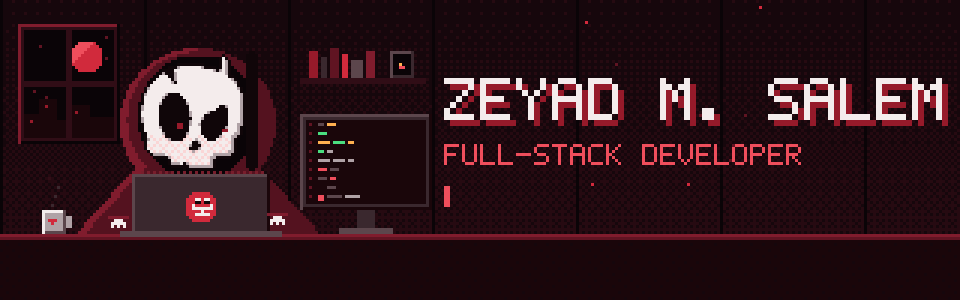

# Zeyad M. Salem

---

### About

I build web apps end to end, from the first conversation with the client to a
product people use every day, and I make sure they're secure and tested before
they ship.

I enforce authorization in the database with Postgres row-level security, keep
sensitive logic on the server, and back it all with automated tests in CI: more
than **2,900 tests** across my projects, including red-team suites that try to
break access control on purpose.

I work in React, TypeScript and Supabase, and I'm comfortable with Arabic and
English interfaces, right-to-left layout included. I use AI coding tools like
Claude Code to move faster, while owning the architecture, the decisions and the
quality.

Computer Science student at **E-JUST**, Alexandria, Egypt (graduating December 2027).
Available for remote freelance and part-time work, up to 20 hours a week.

---

### Featured work

#### [NC Spark](https://github.com/Zeyadmosalem/nc-spark)

**A role-based compliance training platform that can prove who did what.** Four
portals and seven authorable activity types. Quizzes are graded server-side: the
answer key lives in a table no browser role has a grant on, reachable only from an
Edge Function. Privilege escalation is blocked by three independent layers, and the
whole site sits behind a Cloudflare Worker access gate. XP, streaks, badges and
leaderboards all derive from a single append-only ledger, so a badge can never
disagree with its record.

React 19 · Vite 8 · Supabase / Postgres 17 · Edge Functions · Cloudflare Workers
**1,828 tests · 91% statement coverage · red-team security suites**

#### [Samboza](https://github.com/Zeyadmosalem/Samboza) — in production

**A bilingual household finance app, used daily since September 2026.** An
installable Arabic/English PWA with a full right-to-left layout, where Postgres
row-level security, not the screen, decides who reads and writes which rows across
four roles. A double-entry ledger with an audit trail, offline writes through an
idempotent outbox, Excel export, and a CI pipeline that refuses to deploy until the
database has every migration the bundle expects.

React 19 · TypeScript · Supabase / Postgres · Cloudflare Workers · GitHub Actions
**532 pgTAP policy tests · 578 front-end tests · 50 migrations**

#### [Beyond Seen Mistakes](https://github.com/AbdelrahmanAboegela/beyond-seen-mistakes) — test & CI contributor

**I wrote the test suite and CI for a published research pipeline**: data loaders,
the split protocol, training edge cases and reproduction checks. I also made the
reproduction checks compare results numerically instead of bit-for-bit, so they
pass reliably across machines.
[My commits →](https://github.com/AbdelrahmanAboegela/beyond-seen-mistakes/commits?author=Zeyadmosalem)

---

### Publication

**AraBIRD: A Modern Standard Arabic Adaptation of BIRD for Text-to-SQL over English
Schemas.** Co-author. 2026 IEEE 8th NILES Conference (accepted).

---

### Stack

**Front end** `TypeScript` `JavaScript` `React` `Vite` `Tailwind CSS` `TanStack Query` `PWAs` `RTL / Arabic UI`

**Back end & data** `Supabase` `PostgreSQL` `Row-level security` `Edge Functions` `Cloudflare Workers` `Node.js` `SQL` `Python`

**Testing & CI** `Vitest` `pgTAP` `Testing Library` `pytest` `GitHub Actions` `Database migrations` `Git`

---

---

