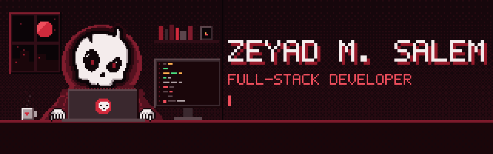

# Zeyad M. Salem

---

### About

I build business web apps end to end: the client portal, the back office, the
database rules that keep each user in their own data, and the tests that prove it.

Most of my work is for the Egyptian and Arabic-speaking market. I've built an
accounting and **ETA e-invoicing** system for an accounting firm, a pipeline that turns
Arabic and English financial-statement PDFs into clean, checked data, and a bilingual
finance app a household has used every day since September 2026.

I work in React, TypeScript, Supabase/Postgres, Python and Django, and every project
ships with automated tests in CI: more than **3,500** across my work, including
red-team suites that try to break access control on purpose. I use AI coding tools
like Claude Code to move faster, while owning the architecture, the decisions and the
quality.

Computer Science student at **E-JUST**, Alexandria, Egypt (graduating December 2027).
Available for remote freelance and part-time work, up to 20 hours a week.

---

### Featured work

#### Accounting & e-invoicing system — client project (private repo)

**A back office and client portal for an Egyptian accounting and tax firm.** Accountants
keep the general ledger, financial statements, VAT returns, payroll and company
formation work; the firm's clients log in to issue e-invoices and track their filings.
It integrates with the Egyptian Tax Authority (ETA) to submit, sync, cancel and reject
e-invoices and receipts, and builds VAT sheets in ETA's official format. Per-department
staff permissions, two-factor sign-in for staff, and an audit log of every change.

Python · Django · PostgreSQL · ETA e-invoicing API · Arabic RTL UI
**~600 tests in CI · 200+ commits · co-developed with one other engineer**

#### Financial statements extraction pipeline — client project (private repo)

**Turns company filings from the Egyptian Exchange into data a benchmarking platform
can import.** It finds and downloads the annual reports, locates the balance sheet,
income statement and cash flow pages, reads them from the PDF text layer with an OCR
fallback for scans (Arabic-Indic digits included), maps every printed line to the
platform's codes, and checks the totals add up before anything is staged for human
review. Built to the client's brief so it can move into their backend without a rewrite.

Python · Pydantic · pdfplumber · Tesseract OCR · SQLite → PostgreSQL · CLI
**~100 tests, including a hand-checked gold set of real filings**

#### [NC Spark](https://github.com/Zeyadmosalem/nc-spark)

**A role-based compliance training platform that can prove who did what.** Four
portals and seven authorable activity types. Quizzes are graded server-side: the
answer key lives in a table no browser role has a grant on, reachable only from an
Edge Function. Privilege escalation is blocked by three independent layers, and the
whole site sits behind a Cloudflare Worker access gate. XP, streaks, badges and
leaderboards all derive from a single append-only ledger, so a badge can never
disagree with its record.

React 19 · Vite 8 · Supabase / Postgres 17 · Edge Functions · Cloudflare Workers
**1,828 tests · 91% statement coverage · red-team security suites**

#### [Samboza](https://github.com/Zeyadmosalem/Samboza) — in production

**A bilingual household finance app, used daily since September 2026.** An
installable Arabic/English PWA with a full right-to-left layout, where Postgres
row-level security, not the screen, decides who reads and writes which rows across
four roles. A double-entry ledger with an audit trail, offline writes through an
idempotent outbox, Excel export, and a CI pipeline that refuses to deploy until the
database has every migration the bundle expects.

React 19 · TypeScript · Supabase / Postgres · Cloudflare Workers · GitHub Actions
**532 pgTAP policy tests · 578 front-end tests · 50 migrations**

---

### More projects

| Project | What it is |
|---|---|
| [arabic-doc-qa](https://github.com/Zeyadmosalem/arabic-doc-qa) | Ask questions about an Arabic or English PDF and get answers with clickable page citations. React front end, FastAPI back end, deployed on Vercel. |
| [Expedition](https://github.com/Zeyadmosalem/Expedition) | An isometric pixel-art shooter for Windows. Every map comes from a constraint solver, and the aliens chase you with BFS, Greedy and A* search. |
| [The Cafe](https://github.com/Zeyadmosalem/Cafe-Website-Project) | A hand-written HTML/CSS/JS site with a canvas arcade game, accessibility built in, and tests in CI. [Live site →](https://zeyadmosalem.github.io/Cafe-Website-Project/) |
| [E-JUST GPA Manager](https://github.com/Zeyadmosalem/ejust-gpa-manager) | In progress: a GPA and degree planner that knows E-JUST's study plans, grading weights and prerequisites. TypeScript engine with tests. |
| [Beyond Seen Mistakes](https://github.com/AbdelrahmanAboegela/beyond-seen-mistakes) | Contributor: I wrote the test suite and CI for a published research pipeline, and made its reproduction checks compare results numerically so they pass on any machine. [My commits →](https://github.com/AbdelrahmanAboegela/beyond-seen-mistakes/commits?author=Zeyadmosalem) |

---

### Publication

**AraBIRD: A Modern Standard Arabic Adaptation of BIRD for Text-to-SQL over English
Schemas.** Co-author. 2026 IEEE 8th NILES Conference (accepted).

---

### Stack

**Front end** `TypeScript` `JavaScript` `React` `Vite` `Tailwind CSS` `TanStack Query` `PWAs` `RTL / Arabic UI`

**Back end** `Supabase` `PostgreSQL` `Row-level security` `Edge Functions` `Django` `FastAPI` `Cloudflare Workers` `Node.js`

**Data & automation** `Python` `SQL` `Pydantic` `PDF extraction` `Tesseract OCR` `Arabic text processing`

**Testing & CI** `Vitest` `pgTAP` `Testing Library` `pytest` `Django test suite` `GitHub Actions` `Database migrations` `Git`

---

---

